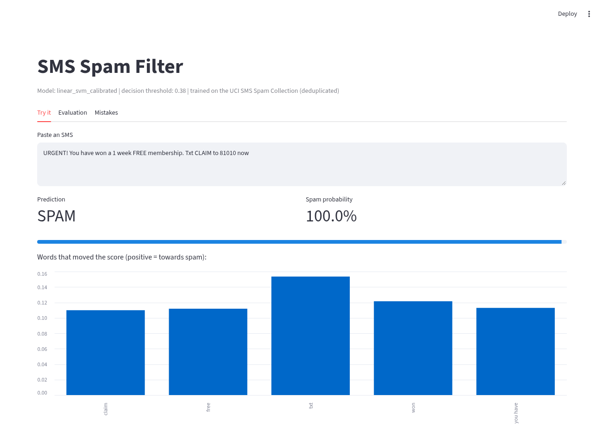
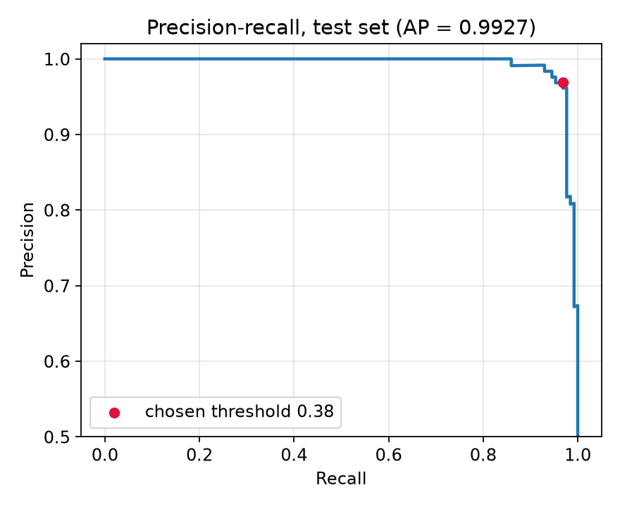
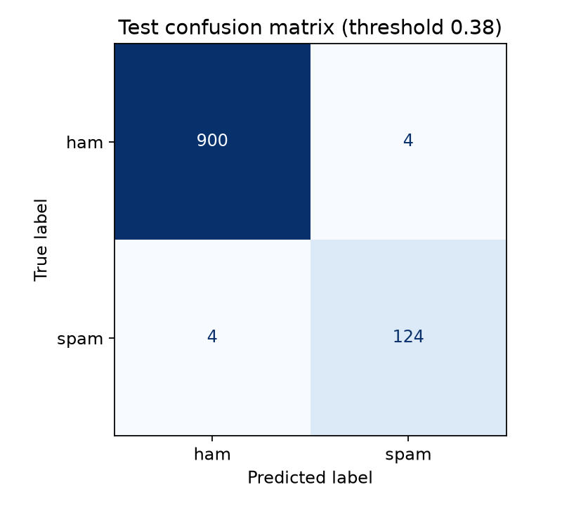
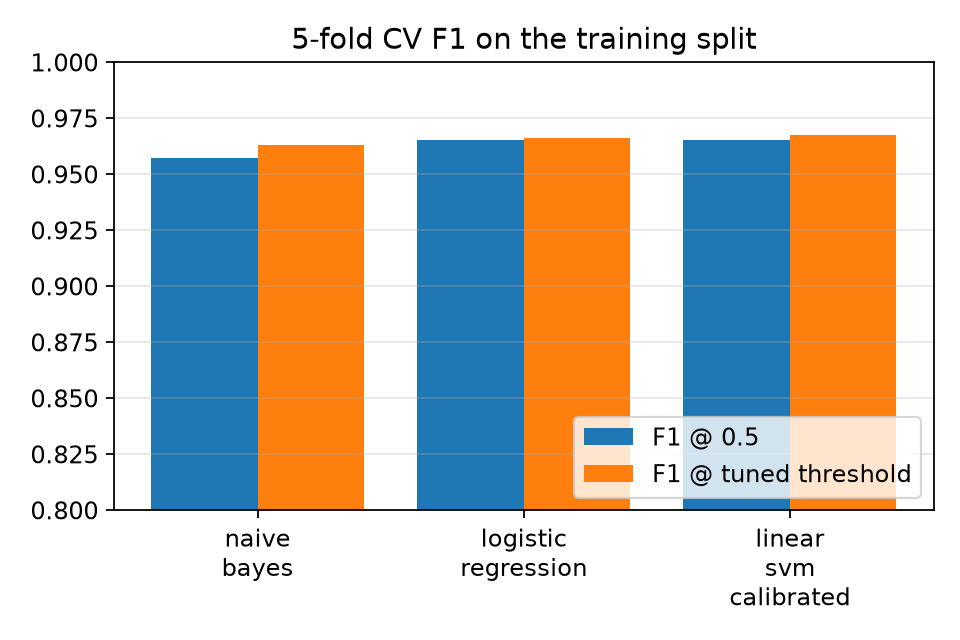
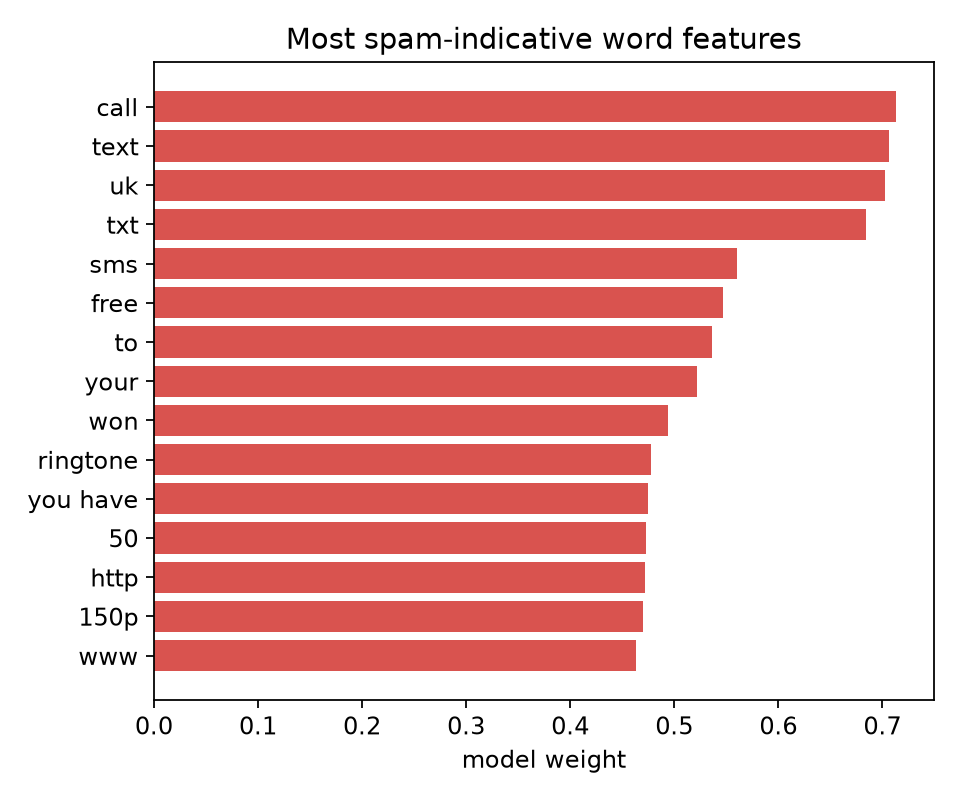

# SMS Spam Filter

An end-to-end text classification project: data cleaning, model comparison with cross-validation,
threshold tuning, a held-out test evaluation, a leakage check, per-message explanations, a CLI and a
Streamlit dashboard. Built with scikit-learn on the public
[UCI SMS Spam Collection](https://archive.ics.uci.edu/dataset/228/sms+spam+collection).



## Problem

Given the text of an SMS, predict whether it is spam. Only about 12% of messages are spam, so accuracy
is a misleading metric (always predicting "ham" already scores about 88%). This project reports
precision, recall, F1 and PR-AUC for the spam class instead.

## Approach

1. **Data**: `src/spamfilter/data.py` downloads the dataset once and caches it in `data/`.
   The raw file has 5,574 rows but only 5,160 unique texts. Exact duplicates are dropped *before*
   splitting so the same message cannot appear in both train and test.
2. **Split**: stratified 80/20 train/test split (`random_state=42`). The test set is used once, at the end.
3. **Features**: TF-IDF word 1-2 grams plus TF-IDF character 2-5 grams (`char_wb`), combined with
   `FeatureUnion`. Character n-grams help with short codes, prices like `150p` and creative spellings.
4. **Models compared** (5-fold stratified CV on the training split only):
   Multinomial Naive Bayes, Logistic Regression (class-balanced), Linear SVM wrapped in
   `CalibratedClassifierCV` so it outputs probabilities.
5. **Threshold tuning**: for each model, the decision threshold that maximises F1 on the
   out-of-fold CV probabilities is chosen. The model with the best tuned CV F1 is selected.
6. **Evaluation**: the selected model is refit on the full training split and scored once on the test set.
7. **Leakage check**: the same pipeline is trained on a split of the raw (not deduplicated) data to
   show how duplicates inflate the score.
8. **Explanations**: for any message, word features are ranked by `tf-idf value x model weight`.

## Results

Numbers below come from `reports/metrics.json` produced by `python train.py` (scikit-learn 1.9.1, Python 3.13).

5-fold CV on the training split (4,128 messages):

| Model | F1 @ 0.5 | Tuned threshold | F1 @ tuned | PR-AUC |
|---|---|---|---|---|
| Naive Bayes | 0.957 | 0.67 | 0.963 | 0.981 |
| Logistic Regression | 0.965 | 0.52 | 0.966 | 0.985 |
| **Linear SVM (calibrated)** | 0.965 | 0.38 | **0.968** | 0.985 |

The three models are close; the differences are within what a different random split could change.

Held-out test set (1,032 messages, 128 spam), Linear SVM at threshold 0.38:

| Precision | Recall | F1 | ROC-AUC | PR-AUC |
|---|---|---|---|---|
| 0.969 | 0.969 | 0.969 | 0.999 | 0.993 |

Confusion matrix: 900 true ham, 4 false positives, 4 missed spam, 124 caught spam.
Prediction cost is about 0.08 ms per message on CPU (batch of 1,032, measured on the dev box).

| | |
|---|---|
|  |  |
|  |  |

**Leakage check**: on a split of the raw data, 139 test messages were exact copies of training
messages, and test F1 read 0.976 instead of 0.969. Deduplicating first gives the more honest number.

**Where it fails** (all 8 test errors are in `reports/errors.json`): spam written in a casual,
personal tone ("Sorry I missed your call let's talk when you have the time. I'm on 0709...") is missed,
and legitimate messages that use promotional vocabulary (a bank security notice, an app invite
mentioning "FREE SMS") get flagged.

## Limitations

- The dataset is small and dated (collected around 2011, mostly UK and Singapore messages). It has no
  modern formats such as OTPs, UPI alerts or delivery-tracking scams, so do not expect these scores
  on a real 2026 inbox.
- One random split; numbers would move a little with a different seed.
- Explanations show word features only; character n-gram features also contribute but are not displayed.

## How to run

```bash
git clone https://github.com/Shibukedang27/sms-spam-filter.git
cd sms-spam-filter
python -m venv .venv && source .venv/bin/activate
pip install -r requirements.txt

python train.py            # downloads data, compares models, writes models/ and reports/ (~25 s)
pytest -q                  # 4 tests
python predict.py --explain "Congratulations! You have won a 500 GBP voucher. Text WIN to 85023"
streamlit run app.py       # dashboard: try it, evaluation, mistakes
```

## Sample output

```
$ python predict.py --explain "Congratulations! You have won a 500 GBP voucher. Text WIN to 85023" \
    "Hey, are we still on for dinner tonight?"
SPAM  p(spam)=0.999  Congratulations! You have won a 500 GBP voucher. Text WIN to 85023
      text (+0.14), won (+0.11), you have (+0.10), win (+0.10), have won (+0.10)
HAM   p(spam)=0.004  Hey, are we still on for dinner tonight?
      for (+0.04), hey (-0.04), still (-0.03), on (+0.03), dinner (-0.03)
```

## Project layout

```
src/spamfilter/data.py    download, parse, deduplicate
src/spamfilter/model.py   pipelines, threshold search, explanations
train.py                  CV comparison, test evaluation, leakage check, charts
predict.py                command-line classifier
app.py                    Streamlit dashboard
tests/                    pytest suite
reports/                  metrics.json, errors.json, charts
```

## Data and license

Dataset: Almeida, T. and Hidalgo, J. (2011). SMS Spam Collection. UCI Machine Learning Repository,
CC BY 4.0. It is downloaded at run time and not stored in this repo. Code: MIT.
